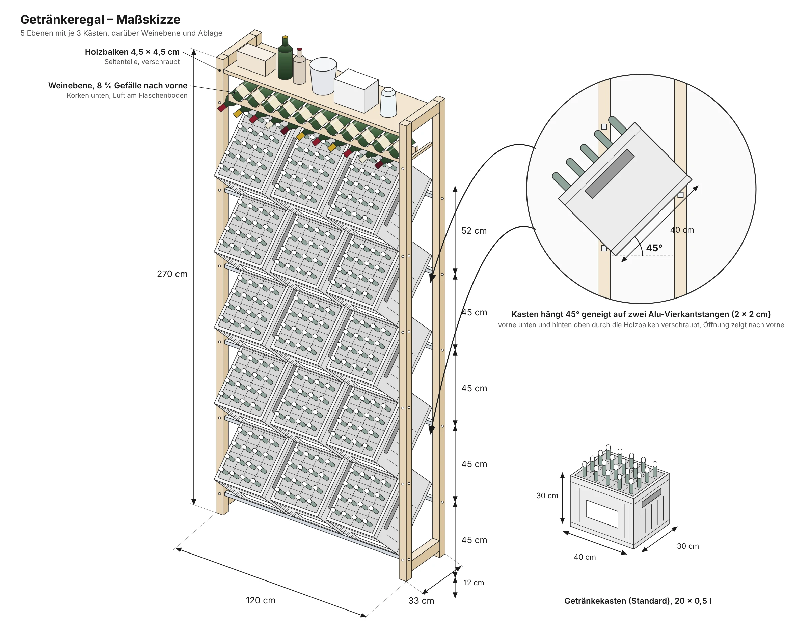

# drinks-rack

Big wooden drinks rack with an extra row for wine bottles above and a shelf on top for extra space.

## How it works

The crates hang at about 45° with the opening to the front, so you can take bottles out without pulling the crate.

Each crate sits on two 20 × 20 mm aluminium square tubes. The upper (back) tube carries the bottom of the crate, the lower (front) tube holds the front wall so it can't slide off.

The wine battens slope down to the front by 8 %. That way the cork stays wet and the air bubble ends up at the bottom of the bottle.

## Dimensions

- Height: 270 cm
- Width: 132 cm, 123 cm between the posts (3 × 40 cm crates plus ~3 cm play)
- Depth: 33 cm (crates stick out at the front)
- 5 crate levels, 45 cm apart, lowest one 12 cm above the floor
- 3 crates per level, standard 20 × 0.5 l (40 × 30 × 30 cm)
- Wine level: 11 bottles

Measure your own crates first. Crates from different breweries are a few cm off from each other.
